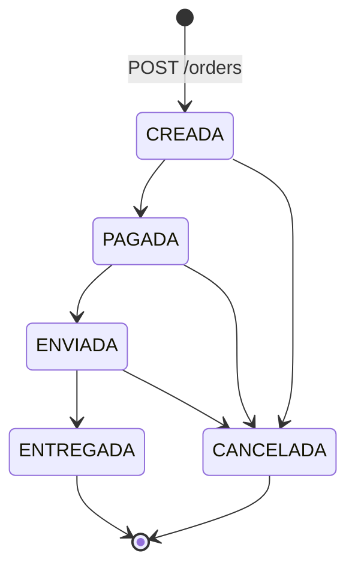
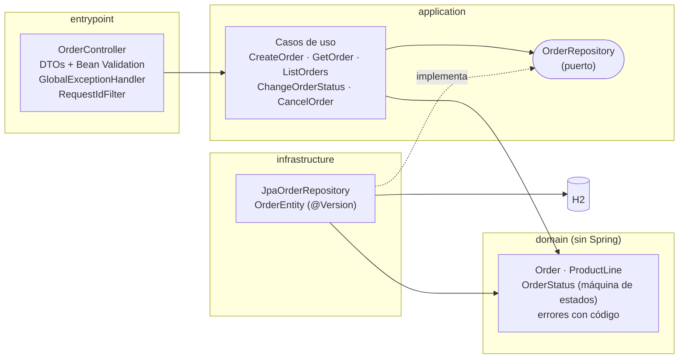
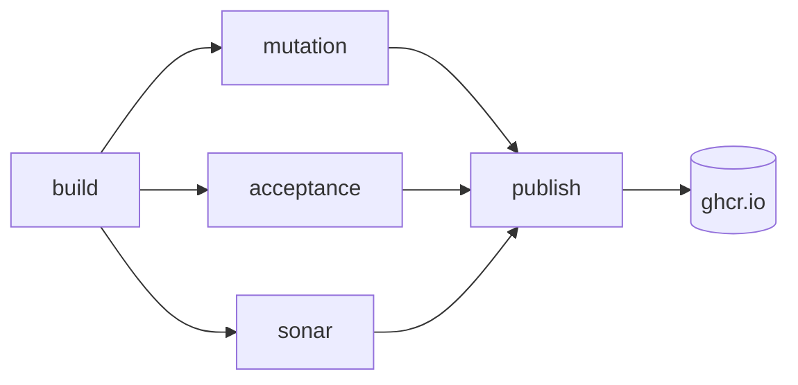

# RTBC Orders API

[](https://github.com/NataliaGarciaB/rtbc-orders-api/actions/workflows/ci.yml)
[](https://sonarcloud.io/project/overview?id=NataliaGarciaB_rtbc-orders-api)
[](https://sonarcloud.io/project/overview?id=NataliaGarciaB_rtbc-orders-api)
[](https://sonarcloud.io/project/overview?id=NataliaGarciaB_rtbc-orders-api)
[](LICENSE)

API REST para gestionar órdenes de compra: creación, consulta y ciclo de vida de la orden, con reglas de negocio protegidas por una estrategia de pruebas basada en riesgo y quality gates automatizados.

| | |
|---|---|
| **Stack** | Java 17 · Spring Boot 4.1 · Spring Data JPA · H2 · Maven Wrapper |
| **Pruebas** | JUnit 6 · Mockito · AssertJ · ArchUnit · JaCoCo · PIT · Karate |
| **Entrega** | Docker · GitHub Actions · SonarCloud · GitHub Container Registry |
| **Calidad actual** | 153 pruebas JUnit · 30 escenarios de aceptación · cobertura 100 % de líneas y ramas · mutation score 100 % |

## Contenido

**Lo esencial**
- [Descripción de la solución](#descripción-de-la-solución)
- [Arquitectura](#arquitectura)
- [Decisiones técnicas](#decisiones-técnicas)
- [Cómo ejecutar la aplicación](#cómo-ejecutar-la-aplicación)
- [Cómo ejecutar las pruebas](#cómo-ejecutar-las-pruebas)
- [Evidencias](#evidencias): [cobertura](#evidencia-de-cobertura) · [mutation testing](#evidencia-de-mutation-testing) · [pipeline](#evidencia-del-pipeline)

**Más detalles**
- [Estrategia de calidad](#estrategia-de-calidad)
- [Uso de la API](#uso-de-la-api)
- [Configuración](#configuración)
- [Tecnologías](#tecnologías)
- [Observabilidad](#observabilidad)
- [Versionamiento](#versionamiento)
- [Uso de IA](#uso-de-ia)
- [Limitaciones conocidas y próximos pasos](#limitaciones-conocidas-y-próximos-pasos)
- [Solución de problemas](#solución-de-problemas)
- [Documentación](#documentación)
- [Estructura del repositorio](#estructura-del-repositorio)
- [Contribuir](#contribuir)
- [Autoría y licencia](#autoría-y-licencia)

---

## Descripción de la solución

### El problema

Una orden de compra pasa por varios estados (se crea, se paga, se envía, se entrega o se cancela) y cada paso tiene reglas: no se puede enviar algo que no se ha pagado, ni cancelar algo que ya se entregó. Cuando esas reglas viven dispersas en el código, aparecen órdenes en estados imposibles, totales mal calculados y errores que el cliente de la API no sabe interpretar.

### La solución

Una API REST que concentra esas reglas en un dominio aislado y probado, y las expone con un contrato estable:

- **Ciclo de vida completo** de la orden con una máquina de estados explícita: cada transición está permitida o rechazada en un único lugar.
- **Total calculado en el servidor** con aritmética decimal exacta: el cliente no puede enviarlo ni manipularlo, y los montos se expresan siempre con 2 decimales.
- **Validación en dos niveles:** la API reporta todos los campos inválidos de una vez y el dominio nunca acepta una orden inválida.
- **Errores predecibles** con formato estándar (RFC 9457) y un código estable para cada caso.
- **Cancelación lógica:** cancelar no borra la orden; se conserva el historial.
- **Protección ante cambios simultáneos** sobre la misma orden (bloqueo optimista).
- **Trazabilidad de cada request** con un id de correlación presente en la respuesta y en los logs.
- **Contrato publicado** en Swagger UI y **despliegue en contenedor** con healthcheck.

### Modelo

Una orden tiene un cliente, una o más líneas de producto, un total calculado y un estado:

```json
{
  "id": "d1fae6ec-f8c9-4e48-adf8-4e76089c668d",
  "cliente": "Juan Pérez",
  "productos": [
    { "id": "P001", "cantidad": 2, "valorUnitario": 100000.00 },
    { "id": "P002", "cantidad": 1, "valorUnitario": 35000.50 }
  ],
  "total": 235000.50,
  "estado": "CREADA"
}
```

### Reglas de negocio

| Regla | Descripción |
|---|---|
| RN-01 | Una orden debe contener al menos un producto |
| RN-02 | La cantidad de cada producto debe ser mayor que cero |
| RN-03 | El total se calcula en el servidor; si el cliente envía un total, se ignora |
| RN-04 | Una orden entregada no puede ser cancelada |
| RN-05 | Una orden no puede ser enviada si no ha sido pagada |
| RN-06 | No se permiten transiciones de estado inválidas |



La matriz completa de las 25 transiciones, con el código HTTP de cada una, está en [`docs/maquina-estados.md`](docs/maquina-estados.md).

### Alcance

| Incluido | Fuera del alcance de esta versión |
|---|---|
| Crear, consultar, listar, cambiar de estado y cancelar órdenes | Autenticación y autorización |
| Reglas de negocio y validaciones de entrada | Persistencia durable (H2 en memoria) |
| Contrato OpenAPI y Swagger UI | Paginación y filtros en el listado |
| Imagen Docker, pipeline de CI y quality gates | Pruebas de carga y rendimiento |

---

## Arquitectura

Arquitectura hexagonal en cuatro capas. Las dependencias apuntan siempre hacia el dominio, y una prueba de ArchUnit rompe el build si alguna regla se viola.



| Capa | Responsabilidad | Regla |
|---|---|---|
| `domain` | Entidades, máquina de estados y reglas RN-01 a RN-06 | No depende de ninguna otra capa ni de frameworks |
| `application` | Un caso de uso por acción y el puerto de persistencia | Depende solo de `domain` |
| `infrastructure` | Adaptador JPA/H2 que implementa el puerto | Nadie depende de ella |
| `entrypoint` | Controlador REST, DTOs, manejo de errores y filtro de correlación | Nadie depende de ella |

El dominio se prueba con JUnit puro, sin levantar Spring, en milisegundos. Cambiar H2 por otra base de datos solo afectaría a `infrastructure`.

---

## Decisiones técnicas

Cada decisión está registrada con su contexto y consecuencias en [`docs/decisiones.md`](docs/decisiones.md) (22 ADR). Las más relevantes:

| Decisión | Por qué |
|---|---|
| Máquina de estados centralizada en `OrderStatus` | Un único lugar define las transiciones; la matriz completa se prueba con una sola prueba parametrizada |
| 400 para enviar sin pagar, 409 para el resto de transiciones inválidas | 400 indica una precondición incumplida; 409, un conflicto con el estado actual del recurso |
| `DELETE` como cancelación lógica que responde 200 con la orden | Se conserva el historial y el resultado se verifica sin una segunda llamada |
| Total calculado en el dominio con `BigDecimal` | El cliente no puede manipularlo y no hay errores de redondeo |
| Validación en el dominio y en los DTOs | El dominio nunca queda inválido; los DTOs reportan todos los errores de una vez |
| Bloqueo optimista con `@Version` | Dos cambios simultáneos sobre la misma orden no pueden saltarse la máquina de estados |
| Contrato de diseño como única fuente de verdad | Swagger UI publica `openapi.yaml` tal cual; no hay una segunda especificación generada que pueda contradecirlo |
| Lectura y escritura estricta de JSON | Una cantidad `1.5` se rechaza en lugar de truncarse a `1`; los decimales nunca salen en notación científica |
| Spring Boot 4.1 | La línea 3.x terminó su soporte gratuito el 2026-06-30 |
| Karate contra el contenedor en CI | Las pruebas de aceptación validan el mismo artefacto que se entrega |
| Actions fijadas por SHA de commit | Una etiqueta como `@v7` se puede mover; fijar el SHA protege el pipeline de la cadena de suministro |

---

## Cómo ejecutar la aplicación

| Para | Necesitas |
|---|---|
| Ejecutar con Docker | Docker con Docker Compose |
| Ejecutar localmente | Java 17 (no hace falta instalar Maven: el proyecto incluye Maven Wrapper) |
| Ejecutar todas las pruebas | Java 17 |
| Ejecutar las pruebas de aceptación sin Java | Docker |

### Con Docker

```bash
docker build -t challenge-api .
docker run -p 8080:8080 challenge-api
```

O con Docker Compose, que espera a que la API esté lista:

```bash
docker compose up --build -d --wait
```

### Localmente

```bash
./mvnw spring-boot:run          # Windows: .\mvnw spring-boot:run
```

Con la API en marcha:

- **Swagger UI:** http://localhost:8080/swagger-ui.html
- **Salud:** http://localhost:8080/actuator/health

La base de datos es H2 en memoria: cada arranque empieza vacío.

Para un recorrido completo por la API con ejemplos de requests y respuestas, ver [Uso de la API](#uso-de-la-api).

---

## Cómo ejecutar las pruebas

| Qué | Comando |
|---|---|
| Unitarias, integración y cobertura (con umbral) | `./mvnw verify` |
| Una sola regla de negocio | `./mvnw test -Dgroups=RN-05` |
| Mutation testing (con umbral) | `./mvnw test-compile org.pitest:pitest-maven:mutationCoverage` |
| Aceptación: levanta la app, ejecuta Karate y la apaga | `./mvnw verify -Pacceptance` |
| Aceptación de una sola regla | `./mvnw verify -Pacceptance -Dkarate.tags=@RN-05` |
| Aceptación contra el contenedor, sin Java | `docker compose --profile acceptance run --rm karate` |
| Verificación completa de la imagen Docker (Windows) | `powershell -ExecutionPolicy Bypass -File .\scripts\verificar-docker.ps1` |

Reportes generados:

| Reporte | Ubicación |
|---|---|
| Cobertura (JaCoCo) | `target/site/jacoco/index.html` |
| Mutación (PIT) | `target/pit-reports/index.html` |
| Aceptación (Karate) | `target/karate-reports/karate-summary.html` |

---

## Evidencias

Las cifras corresponden al estado actual de `main` ([ejecuciones del pipeline](https://github.com/NataliaGarciaB/rtbc-orders-api/actions/workflows/ci.yml?query=branch%3Amain)). Cada ejecución publica los reportes completos como artifacts y un resumen de métricas.

### Evidencia de cobertura

**100 % de líneas (250/250) y 100 % de ramas (57/57)** con JaCoCo; el umbral mínimo del pipeline es 80 %.

- Reporte: artifact `cobertura-jacoco` de cada ejecución; en local, `target/site/jacoco/index.html`.
- Solo se excluye la clase de arranque de Spring Boot, que no tiene lógica ([ADR-013](docs/decisiones.md#adr-013-exclusiones-de-cobertura-y-mutación)).
- La misma cobertura se publica en [SonarCloud](https://sonarcloud.io/project/overview?id=NataliaGarciaB_rtbc-orders-api).

### Evidencia de mutation testing

**66 de 66 mutantes eliminados (100 %)** con PIT y sus mutadores STRONGER sobre `domain` y `application`; el umbral mínimo del pipeline es 70 %.

- Reporte: artifact `mutacion-pit` de cada ejecución; en local, `target/pit-reports/index.html`.

### Evidencia del pipeline

[Ejecuciones en `main`](https://github.com/NataliaGarciaB/rtbc-orders-api/actions/workflows/ci.yml?query=branch%3Amain), con los cinco jobs en verde. Historial: [GitHub Actions](https://github.com/NataliaGarciaB/rtbc-orders-api/actions/workflows/ci.yml).

#### Quality gates

Cada gate es un job del pipeline y un check obligatorio para hacer merge a `main`:

| Gate | Umbral | Job |
|---|---|---|
| Pruebas | 0 fallidas, también ejecutadas en orden inverso | `build` |
| Cobertura de líneas y de ramas | ≥ 80 % | `build` (JaCoCo) |
| Mutation score | ≥ 70 % | `mutation` (PIT) |
| Aceptación | 30/30 escenarios contra el contenedor | `acceptance` (Karate) |
| Análisis estático | Quality gate de SonarCloud en verde | `sonar` |



`publish` solo corre en `main` y en tags `v*`, y publica en GHCR la misma imagen que validó Karate.

#### El pipeline bloquea cambios que no cumplen los quality gates

El [PR #9](https://github.com/NataliaGarciaB/rtbc-orders-api/pull/9) introdujo a propósito tres problemas, uno por ejecución, y se cerró sin merge:

| Etapa | Cambio | Resultado | Ejecución |
|---|---|---|---|
| 1 | Se rompe RN-05 | ❌ `build`: 4 pruebas fallan | [ver](https://github.com/NataliaGarciaB/rtbc-orders-api/actions/runs/39338585896) |
| 2 | Código nuevo sin pruebas | ❌ `build`: las pruebas pasan, pero la cobertura de ramas baja a 72 % | [ver](https://github.com/NataliaGarciaB/rtbc-orders-api/actions/runs/39339430837) |
| 3 | Una prueba que ejecuta el código sin verificar nada | ✅ `build` (100 % de líneas) y ✅ `sonar` · ❌ `mutation`: 66 % | [ver](https://github.com/NataliaGarciaB/rtbc-orders-api/actions/runs/39340382138) |

La etapa 3 muestra por qué el mutation testing es un gate: la cobertura y el análisis estático dieron el cambio por bueno porque el código se ejecuta, pero solo PIT detectó que la prueba no verifica ningún resultado.

#### Otras verificaciones

| Verificación | Resultado | Detalle |
|---|---|---|
| Aceptación (Karate contra el contenedor) | **30 de 30 escenarios** en 6 features | Artifact `aceptacion-karate`; se inyectaron defectos para comprobar que los escenarios críticos los detectan ([detalle](docs/qa/estrategia-pruebas.md#9-pruebas-de-aceptación-con-karate)) |
| Análisis estático (SonarCloud) | **Quality gate en verde**, calificación A en seguridad, confiabilidad y mantenibilidad | [Proyecto en SonarCloud](https://sonarcloud.io/project/overview?id=NataliaGarciaB_rtbc-orders-api) |
| Imagen Docker | Construcción, ejecución, contenedor `healthy`, usuario sin privilegios, logs JSON y Karate: 9 de 9 verificaciones | [docs/docker.md](docs/docker.md#evidencia-de-ejecución) |

En el primer análisis, SonarCloud detectó que las actions del pipeline estaban referenciadas por etiqueta (`@v7`) y no por SHA, un riesgo de cadena de suministro. Se corrigió fijando todas por SHA de commit.

---

# Más detalles

## Estrategia de calidad

La estrategia completa está en [`docs/qa/estrategia-pruebas.md`](docs/qa/estrategia-pruebas.md) y la relación de cada regla con su riesgo y sus pruebas en [`docs/qa/trazabilidad.md`](docs/qa/trazabilidad.md).

### Basada en riesgo

El esfuerzo de prueba se concentra donde un fallo hace más daño:

| Riesgo | Nivel | Cómo se mitiga |
|---|---|---|
| R01: se permite una transición inválida | **Alto** | Matriz de 25 transiciones en el dominio, casos de uso, API y muestra en Karate |
| R02: total mal calculado o manipulado | **Alto** | Decimales, valores grandes y total enviado por el cliente, de punta a punta hasta la base de datos |
| R03: se crea una orden inválida | **Alto** | Valores límite en dominio, DTO y Karate |
| R09: pruebas que pasan sin detectar regresiones | **Alto** | Mutation testing con PIT (mutadores STRONGER) |
| R04-R06: errores inconsistentes, entradas inesperadas, fuga de información | Medio | Pruebas de integración web y del manejador de errores |
| R07: el contenedor se comporta distinto que en local | Medio | Karate contra el contenedor en cada ejecución del pipeline |
| R08: cambios concurrentes | Bajo | Prueba con dos transacciones reales |

### Pirámide de pruebas

Cada comportamiento se prueba en el nivel más bajo posible; los niveles superiores confirman la integración.

| Nivel | Herramienta | Cantidad |
|---|---|---|
| Aceptación sobre el contenedor | Karate | 30 escenarios |
| Integración web y de aplicación | `@WebMvcTest`, `@SpringBootTest` | 55 pruebas |
| Integración de persistencia | `@DataJpaTest` (H2) | 6 pruebas |
| Arquitectura | ArchUnit | 2 reglas |
| Unitarias de casos de uso | JUnit + Mockito | 16 pruebas |
| Unitarias de dominio | JUnit | 74 pruebas |

Técnicas de diseño: transición de estados (matriz completa), valores límite, particiones de equivalencia y tablas de decisión.

---

## Uso de la API

| Método | Ruta | Descripción | Respuestas |
|---|---|---|---|
| `POST` | `/orders` | Crea una orden en estado `CREADA` | 201 · 400 |
| `GET` | `/orders` | Lista las órdenes | 200 |
| `GET` | `/orders/{id}` | Consulta una orden | 200 · 400 · 404 |
| `PATCH` | `/orders/{id}/status` | Cambia el estado | 200 · 400 · 404 · 409 |
| `DELETE` | `/orders/{id}` | Cancela la orden (cancelación lógica) | 200 · 404 · 409 |

El contrato completo está en [`docs/api/openapi.yaml`](docs/api/openapi.yaml).

### Ejemplo: ciclo de vida de una orden

**1. Crear la orden.** El total lo calcula el servidor:

```bash
curl -i -X POST http://localhost:8080/orders \
  -H "Content-Type: application/json" \
  -d '{"cliente":"Juan Pérez","productos":[{"id":"P001","cantidad":2,"valorUnitario":100000}]}'
```

```http
HTTP/1.1 201
Location: http://localhost:8080/orders/d1fae6ec-f8c9-4e48-adf8-4e76089c668d
X-Request-Id: 4bf1f04f-aca3-4518-96fe-4cf52c595728
Content-Type: application/json

{"id":"d1fae6ec-f8c9-4e48-adf8-4e76089c668d","cliente":"Juan Pérez","productos":[{"id":"P001","cantidad":2,"valorUnitario":100000.00}],"total":200000.00,"estado":"CREADA"}
```

**2. Intentar enviarla sin pagar.** La regla RN-05 lo impide:

```bash
curl -X PATCH http://localhost:8080/orders/{id}/status \
  -H "Content-Type: application/json" -d '{"estado":"ENVIADA"}'
```

```json
{
  "title": "Bad Request",
  "status": 400,
  "detail": "La orden no puede ser enviada si no ha sido pagada",
  "instance": "/orders/d1fae6ec-f8c9-4e48-adf8-4e76089c668d/status",
  "codigo": "ORDEN_NO_PAGADA"
}
```

**3. Pagar, enviar y entregar.** Cada paso responde `200` con la orden actualizada:

```bash
curl -X PATCH http://localhost:8080/orders/{id}/status -H "Content-Type: application/json" -d '{"estado":"PAGADA"}'
curl -X PATCH http://localhost:8080/orders/{id}/status -H "Content-Type: application/json" -d '{"estado":"ENVIADA"}'
curl -X PATCH http://localhost:8080/orders/{id}/status -H "Content-Type: application/json" -d '{"estado":"ENTREGADA"}'
```

**4. Intentar cancelar la orden entregada.** La regla RN-04 lo impide:

```bash
curl -X DELETE http://localhost:8080/orders/{id}
```

```json
{
  "title": "Conflict",
  "status": 409,
  "detail": "No se puede pasar de ENTREGADA a CANCELADA",
  "instance": "/orders/d1fae6ec-f8c9-4e48-adf8-4e76089c668d",
  "codigo": "TRANSICION_INVALIDA"
}
```

### Ejemplo: errores de validación

Todos los campos inválidos se reportan en una sola respuesta:

```json
{
  "title": "Bad Request",
  "status": 400,
  "detail": "La solicitud contiene errores de validación",
  "instance": "/orders",
  "codigo": "VALIDACION",
  "errores": [
    { "campo": "cliente", "mensaje": "es obligatorio" },
    { "campo": "productos[0].cantidad", "mensaje": "debe ser mayor que cero" },
    { "campo": "productos[0].valorUnitario", "mensaje": "admite máximo 17 enteros y 2 decimales" }
  ]
}
```

### Errores

Todas las respuestas de error usan `application/problem+json` (RFC 9457) con un `codigo` estable, para que los clientes no dependan del texto del mensaje:

| Código HTTP | `codigo` | Cuándo |
|---|---|---|
| 400 | `VALIDACION` | Datos inválidos; `errores` indica cada campo (por ejemplo `productos[0].cantidad`) |
| 400 | `ORDEN_NO_PAGADA` | Enviar una orden que no ha sido pagada (RN-05) |
| 404 | `ORDEN_NO_ENCONTRADA` | La orden no existe |
| 409 | `TRANSICION_INVALIDA` | Transición no permitida desde el estado actual (RN-04, RN-06) o modificación concurrente |
| 500 | `ERROR_INTERNO` | Error inesperado, sin detalles internos en la respuesta |

### Id de correlación

Envía el header `X-Request-Id` para seguir un request en los logs. Si no lo envías, o si no es seguro (solo se aceptan letras, números, `.`, `_` y `-`, hasta 64 caracteres), la API genera uno. Siempre se devuelve en la respuesta.

---

## Configuración

La API funciona sin configuración. Estos son los valores que se pueden ajustar:

| Qué | Cómo | Por defecto |
|---|---|---|
| Puerto | `--server.port=9090` o la variable `SERVER_PORT` | `8080` |
| Formato de logs | Perfil `docker` (`SPRING_PROFILES_ACTIVE=docker`): logs JSON | Texto legible en local; JSON en la imagen Docker |
| Memoria de la JVM en el contenedor | Variable `JAVA_TOOL_OPTIONS` | `-XX:MaxRAMPercentage=75` (75 % de la memoria del contenedor) |
| Puerto de la app en las pruebas de aceptación | `-Dacceptance.port=18080` | `18080` (no choca con una app en 8080) |
| Entorno de Karate | `-Dkarate.env=local` · `docker` · `compose` | `local` |

La configuración está en [`application.properties`](src/main/resources/application.properties) y en [`application-docker.properties`](src/main/resources/application-docker.properties), cada propiedad con un comentario que explica su motivo.

---

## Tecnologías

| Ámbito | Tecnología | Versión |
|---|---|---|
| Lenguaje y runtime | Java (Eclipse Temurin) | 17 |
| Framework | Spring Boot · Spring Framework | 4.1.1 · 7.0 |
| Web | Spring MVC sobre Tomcat | 11.0 |
| Persistencia | Spring Data JPA sobre Hibernate · H2 | Hibernate 7.4 · H2 2.4 |
| JSON | Jackson | 3.1 |
| Documentación de la API | OpenAPI 3.0 · Swagger UI | 5.32 |
| Build | Maven Wrapper | Maven 3.10 |
| Pruebas unitarias e integración | JUnit · Mockito · AssertJ | 6.0 · 5.23 · 3.27 |
| Arquitectura | ArchUnit | 1.5 |
| Cobertura | JaCoCo | 0.8.15 |
| Mutation testing | PIT | 1.30 |
| Aceptación | Karate | 1.5.2 |
| Contenedor | Docker · Docker Compose | — |
| CI/CD | GitHub Actions · GitHub Container Registry | — |
| Análisis estático | SonarCloud | — |

---

## Observabilidad

| Qué | Cómo |
|---|---|
| Eventos de negocio | Logs de `Orden creada`, `Estado cambiado` y `Transición rechazada` (con su `codigo`), en formato `clave=valor` y sin datos personales |
| Correlación | Cada request lleva un `X-Request-Id` que aparece en todas sus líneas de log y en la respuesta. Un valor enviado por el cliente solo se reutiliza si es seguro, para evitar inyección en los logs |
| Logs en el contenedor | JSON (Elastic Common Schema) con `requestId` como campo propio |
| Errores inesperados | La excepción completa queda en el log; la respuesta al cliente es genérica |
| Salud | `/actuator/health`, el único endpoint de actuator expuesto, sin detalles internos |
| Pipeline | Resumen de cobertura, mutación y aceptación en cada ejecución; reportes como artifacts |

---

## Versionamiento

- **Conventional Commits** en español: `tipo(ámbito): descripción` ([guía](CONTRIBUTING.md)).
- **Una rama por fase**, integrada mediante PR con **merge commit**, para conservar la secuencia TDD en el historial: cada regla de negocio tiene un commit `test(...)` en rojo seguido de un commit `feat(...)` en verde.
- **`main` protegida:** sin push directo ni force push; merge solo con los checks `build`, `mutation`, `acceptance` y `sonar` en verde.
- **Tags semánticos por fase** (`v0.1.0` a `v1.0.0`), que además publican la imagen versionada en GHCR.

---

## Uso de IA

Usé **Claude Code** (Anthropic) como potenciador de mi trabajo de ingeniería: me permitió acelerar la implementación y dedicar más tiempo a lo que define la calidad de una solución, que es el diseño, el análisis de riesgo y la verificación, sin delegar el criterio.

| Lo que aporté | Cómo me apoyó la IA |
|---|---|
| La estrategia de pruebas basada en riesgo, el alcance de cada fase y las decisiones técnicas | Proponer alternativas con sus ventajas y desventajas para decidir con más información |
| El diseño de la arquitectura, del contrato de la API y de la máquina de estados | Implementar con TDD a partir de ese diseño y documentar cada decisión |
| La revisión de cada cambio antes de integrarlo, la prueba exploratoria y la validación de la imagen en Docker | Automatizar verificaciones repetitivas, como probar cada commit por separado o inyectar defectos para comprobar que las pruebas los detectan |
| El criterio para aceptar, ajustar o descartar cada propuesta | Investigar compatibilidad de versiones, configuraciones y comportamientos de las herramientas |

Prácticas para un uso responsable:

- **Nada se integró sin revisión.** Cada fase se revisó localmente antes de publicarse, y ningún cambio llega a `main` sin pasar los quality gates.
- **Verificación antes que confianza.** TDD con commits en rojo y en verde visibles en el historial, mutation testing y defectos inyectados a propósito para comprobar que las pruebas los detectan.
- **Las propuestas también se pusieron a prueba.** Así aparecieron hallazgos como una dependencia entre pruebas que solo se manifestaba en el CI (Linux), Jackson 3 truncando cantidades decimales sin avisar y actions del pipeline sin fijar por SHA. Todos se corrigieron con su prueba o su control correspondiente.
- **Sin datos sensibles.** Los tokens existen solo como secretos de GitHub y los logs no registran datos personales.

---

## Limitaciones conocidas y próximos pasos

| Limitación actual | Próximo paso posible |
|---|---|
| H2 en memoria: los datos se pierden al reiniciar | Base de datos persistente (por ejemplo PostgreSQL) con migraciones versionadas; solo cambia la capa `infrastructure` |
| Sin autenticación ni autorización | OAuth 2.0 / JWT con Spring Security |
| `GET /orders` sin paginación ni filtros | Paginación y filtro por estado, sin romper el contrato actual |
| Imagen de 480 MB sin comprimir | Base JRE más liviana o un runtime reducido con `jlink` |
| Actions fijadas por SHA que no se actualizan solas | Dependabot para proponer las actualizaciones con su revisión |
| Sin historial de cambios de estado consultable | Auditoría de transiciones (quién, cuándo, de qué estado a cuál) |

---

## Solución de problemas

| Síntoma | Causa probable | Solución |
|---|---|---|
| `Port 8080 was already in use` | Otra aplicación usa el puerto | Detenerla o arrancar con `--server.port=9090` |
| `./mvnw: Permission denied` (Linux/macOS) | El script perdió el permiso de ejecución (por ejemplo, al descargar el repositorio como ZIP) | `chmod +x mvnw` |
| Las tildes de los logs se ven mal en la consola de Windows | La consola de Windows no usa UTF-8 por defecto | Es solo visual: los datos no se alteran y los logs del contenedor (JSON) se ven correctamente |
| `docker build` falla al descargar dependencias | Proxy o certificado de una red corporativa | Configurar el proxy en Docker o probar desde otra red |
| Las pruebas de aceptación fallan con `connection refused` | La API no está levantada en la URL del entorno elegido | Con `-Pacceptance` Maven la levanta solo; con `-Dkarate.env=docker`, levantar antes el contenedor |
| Un request de `curl` con tildes responde 400 en algunas terminales de Windows | La terminal envía el texto en otra codificación | Enviar el body desde un archivo UTF-8 o usar Swagger UI |

---

## Documentación

| Documento | Contenido |
|---|---|
| [`docs/api/openapi.yaml`](docs/api/openapi.yaml) | Contrato de la API |
| [`docs/decisiones.md`](docs/decisiones.md) | Registro de las 22 decisiones técnicas (ADR) |
| [`docs/maquina-estados.md`](docs/maquina-estados.md) | Matriz de transiciones y códigos HTTP |
| [`docs/qa/estrategia-pruebas.md`](docs/qa/estrategia-pruebas.md) | Estrategia de pruebas, riesgos, pirámide y quality gates |
| [`docs/qa/trazabilidad.md`](docs/qa/trazabilidad.md) | Relación de cada requisito con su riesgo y sus pruebas |
| [`docs/docker.md`](docs/docker.md) | Ejecución con Docker y evidencia de verificación |
| [`CONTRIBUTING.md`](CONTRIBUTING.md) | Commits, ramas, pull requests y versiones |

---

## Estructura del repositorio

```
├── src/main/java/com/rtbc/orders
│   ├── domain/            Entidades, máquina de estados, reglas de negocio
│   ├── application/       Casos de uso y puerto de persistencia
│   ├── infrastructure/    Adaptador JPA/H2
│   └── entrypoint/        API REST, errores, correlación
├── src/test/java          Pruebas unitarias, de integración y de arquitectura
├── src/test/resources/acceptance   Escenarios Karate
├── docs/
│   ├── api/openapi.yaml   Contrato de la API
│   ├── decisiones.md      Registro de decisiones (ADR)
│   ├── maquina-estados.md Transiciones y códigos HTTP
│   ├── docker.md          Ejecución con Docker y evidencia
│   └── qa/                Estrategia de pruebas y trazabilidad
├── scripts/verificar-docker.ps1
├── Dockerfile · docker-compose.yml · .dockerignore
└── .github/workflows/ci.yml
```

---

## Contribuir

Las convenciones de commits, ramas y pull requests están en [`CONTRIBUTING.md`](CONTRIBUTING.md). En resumen: una rama por cambio, TDD (prueba primero), Conventional Commits y un pull request que solo se integra con los quality gates en verde.

---

## Autoría y licencia

Desarrollado por **Natalia Garcia** ([@NataliaGarciaB](https://github.com/NataliaGarciaB)).

Distribuido bajo la licencia [MIT](LICENSE).
