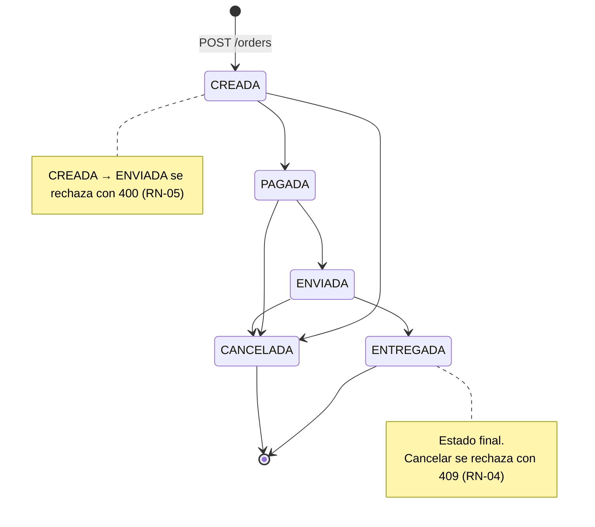

# Máquina de estados de la orden

Cubre RN-04, RN-05 y RN-06. La implementación vive en un solo lugar, el enum `OrderStatus` del dominio (ver [ADR-004](decisiones.md#adr-004-máquina-de-estados-en-el-dominio)).

## Diagrama

## Matriz completa de transiciones

Se llega a cada celda con `PATCH /orders/{id}/status` y body `{"estado": "<destino>"}`. Cancelar con `DELETE /orders/{id}` equivale a la columna `CANCELADA`.

| Actual ↓ / Destino → | CREADA | PAGADA | ENVIADA | ENTREGADA | CANCELADA |
|---|---|---|---|---|---|
| **CREADA** | 409 | ✅ 200 | ❌ **400** (RN-05) | 409 | ✅ 200 |
| **PAGADA** | 409 | 409 | ✅ 200 | 409 | ✅ 200 |
| **ENVIADA** | 409 | 409 | 409 | ✅ 200 | ✅ 200 |
| **ENTREGADA** | 409 | 409 | 409 | 409 | ❌ **409** (RN-04) |
| **CANCELADA** | 409 | 409 | 409 | 409 | 409 |

**Resumen:** hay 5 transiciones válidas, 1 inválida con 400 y 19 inválidas con 409. Las 25 combinaciones son la base de la prueba parametrizada de RN-06 en el dominio y del `Scenario Outline` de Karate.

## Decisiones de borde
| Caso | Respuesta | Motivo |
|---|---|---|
| `CREADA → ENVIADA` | 400 `ORDEN_NO_PAGADA` | RN-05: falta una precondición, el pago. |
| `CANCELADA → ENVIADA` | 409 `TRANSICION_INVALIDA` | La orden está en un estado final. El conflicto es con ese estado, no con el pago. |
| `CREADA → ENTREGADA` | 409 `TRANSICION_INVALIDA` | Salta estados. RN-05 se refiere solo a *enviar*. |
| Mismo estado (`PAGADA → PAGADA`) | 409 `TRANSICION_INVALIDA` | No es una transición. Rechazarla evita falsos éxitos. |
| Estado desconocido o ausente (`{"estado": "PERDIDA"}`) | 400 `VALIDACION` | Es un error de formato del request, no de negocio. |
| Orden inexistente | 404 `ORDEN_NO_ENCONTRADA` | Se valida antes que la transición. |
